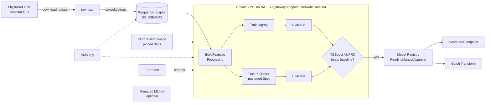

# Sepsis early warning on Amazon SageMaker (PhysioNet/CinC 2019)

An hourly sepsis early-warning model, built to show a secure, reproducible SageMaker workflow:
data ingestion, causal feature engineering in a custom container, training, patient-level
bootstrap evaluation on an **external hospital**, a SageMaker Pipeline with conditional model
registration, and serving. This is more of a demo of the pipeline and engineering practices rather 
than a model with state-of-the-art performance.

> **Research demonstration only. Not a medical device and not for clinical use.**

## Status

| Piece | State |
|---|---|
| Secure environment (Terraform: VPC, KMS, S3, IAM, ECR, budget) | Done, applied |
| Ingestion, consolidation, data summary | Done, counts reconcile ([docs/data_summary.md](docs/data_summary.md)) |
| Causal features + patient-level splits, SageMaker Processing job | Done; cloud output identical to local run |
| Training (logistic regression, XGBoost), local | Done |
| Evaluation with patient-bootstrap CIs, hospital B external | Done (SageMaker pipeline run, tuned model) |
| SHAP and subgroup analysis (Clarify fallback) | Done (on the registered model; v3 is identical) |
| SageMaker Pipeline with conditional registration | Executed end to end on SageMaker (all 7 steps succeeded); tuned XGBoost registered (v3 is the approved, deployable version) |
| SageMaker training jobs, hyperparameter tuning, MLflow | Done: 20-trial Bayesian tuning job ([docs/tuning_result.json](docs/tuning_result.json)); runs logged to managed MLflow |
| Serverless endpoint, Batch Transform | Done: endpoint invoked and deleted; Batch Transform scores match `evaluate.py` (see below) |

Numbers below come from the SageMaker pipeline run (`scripts/render_results.py` fills them from
the evaluation output, so they are never hand-copied).

## Architecture



Everything is created by Terraform (`infra/`) and driven from your machine with the SageMaker
Python SDK. One custom image (`container/`) runs feature building, training, evaluation and
inference, so the same `features.py` is used offline and at serving time.

## Methodology rules (enforced by code and tests)

1. Hospital A is split into train/validation **by patient**, stratified on ever-septic; hospital B is
   only ever used for final evaluation.
2. Nothing is tuned on hospital B: hyperparameters, calibration and the alert threshold are fit on
   hospital A validation.
3. Features are causal: a feature at hour *t* uses only rows at hours ≤ *t* (tested by perturbing
   later rows; serving is tested the same way).
4. Fitted preprocessing (imputation, scaling) is fit on the training fold only.
5. Confidence intervals come from a bootstrap that resamples patients, not rows (tested).

## Results

<!-- results:headline:start -->
_Source: SageMaker Pipeline executions c4hbrf2kv8hz (package v2) and 9ot5kpyg2m70 (package v3, the deployed one), which produced identical metrics; XGBoost with Phase 5 tuned hyperparameters. 95% CIs from 1000 patient-level bootstrap resamples. Calibration and alert threshold fit on hospital A validation only; hospital B is an untouched external test set._

| Metric | XGBoost, A validation | XGBoost, B (external) | Logistic regression, A validation | Logistic regression, B |
|---|---|---|---|---|
| Patients (septic) | 4,067 (358) | 20,000 (1,142) | 4,067 (358) | 20,000 (1,142) |
| Hour prevalence | 0.0216 | 0.0141 | 0.0216 | 0.0141 |
| AUROC | 0.809 (0.791-0.829) | 0.786 (0.775-0.798) | 0.754 (0.732-0.776) | 0.711 (0.696-0.725) |
| AUPRC | 0.132 (0.111-0.157) | 0.072 (0.065-0.081) | 0.097 (0.087-0.115) | 0.049 (0.045-0.056) |
| Brier (calibrated) | 0.020 (0.018-0.022) | 0.014 (0.013-0.014) | 0.020 (0.018-0.022) | 0.015 (0.014-0.017) |
| Challenge utility (normalised) | 0.399 (0.355-0.439) | 0.245 (0.222-0.268) | 0.332 (0.287-0.372) | 0.193 (0.168-0.218) |
| Median lead time, h | 36.5 (29.0-44.5) | 33.0 (29.0-39.0) | 38.0 (30.0-45.0) | 30.0 (26.0-37.0) |
| Septic patients alerted before onset | 0.732 (0.686-0.778) | 0.475 (0.448-0.504) | 0.737 (0.693-0.783) | 0.593 (0.564-0.620) |
| False alarms per non-septic patient-day | 2.34 (2.17-2.50) | 0.79 (0.71-0.88) | 2.98 (2.81-3.15) | 2.07 (1.97-2.18) |

XGBoost alert threshold: 0.0332 (calibrated probability).
<!-- results:headline:end -->

Reading the table: discrimination and utility are lower on hospital B, the expected cost of external validation.
Hour prevalence also differs (A 2.2%, B 1.4%), so AUPRC is not comparable across hospitals; compare
each against its own prevalence. The alert threshold maximises the challenge utility, which charges
very little for false alarms. On hospital A it alerts on 16% of patient-hours (2.3 false alarms per
non-septic patient-day) and still alerts before onset for only 73% of septic patients; on B it
alerts on 6% of hours (0.8 per patient-day) and reaches 48%. That is not a clinically usable trade-off (see [docs/future_work.md](docs/future_work.md)).

### What drives the model (XGBoost, SHAP)

<!-- results:shap:start -->
| Variable | Share of total |SHAP|, A validation | Share, B |
|---|---|---|
| FiO2 | 14.1% | 12.3% |
| ICULOS | 13.0% | 11.4% |
| Temp | 7.4% | 6.6% |
| Lactate | 6.5% | 5.9% |
| Resp | 6.1% | 5.4% |
| SBP | 5.4% | 4.9% |
| Creatinine | 4.1% | 4.5% |
| WBC | 3.7% | 3.9% |
<!-- results:shap:end -->

More in [docs/model_card.md](docs/model_card.md).

## Reproduce

Prerequisites: Python 3.11 and [uv](https://docs.astral.sh/uv/), Terraform ≥ 1.6, AWS CLI, Docker,
an AWS account/profile. On macOS, XGBoost needs `brew install libomp`.

```bash
uv sync --extra dev
cp config/settings.example.yaml config/settings.yaml      # edit: profile, region, owner, budget email
scripts/infra.sh apply                                    # BILLABLE resources: read infra/ first
uv run python scripts/consolidate.py --upload             # after scripts/download_data.sh
uv run python scripts/explore.py                          # -> docs/data_summary.md
uv run python -m sepsis.process --input data/parquet --output data/features
scripts/push_image.sh                                     # build + push the custom image
uv run python scripts/run_processing.py --compare-local data/features   # Phase 3 acceptance
uv run python -m sepsis.train --model xgboost --train data/features/train \
    --validation data/features/validation --model-dir outputs/xgboost_full
uv run python -m sepsis.evaluate --model-dir outputs/xgboost_full --features data/features \
    --out outputs/eval_xgboost
uv run python scripts/run_pipeline.py --upsert --start    # features -> train -> evaluate -> register
make test lint                                            # unit tests and ruff
scripts/teardown.sh                                       # delete everything
```

Each script runs locally on a small sample first (`consolidate.py --limit 500`). Some accounts
start with **zero quota for training and transform instances**; request `ml.m5.large` training,
Spot training and transform quota early, as approval can take a day.

### Calling the endpoint

Request format ([docs/sample_request.json](docs/sample_request.json) is a 12-hour example):

```json
{"patient_id": "B_p100013",
 "records": [{"ICULOS": 1, "HR": 84, "O2Sat": 98, "Age": 89, "Gender": 1}, "... one row per ICU hour ..."],
 "all_hours": false}
```

Response from the deployed serverless endpoint (model package v3; saved as
[docs/sample_response.json](docs/sample_response.json)). The cold start and a warm call returned
identical scores:

```json
{"patient_id": "B_p100013", "iculos": 12, "n_hours": 12, "risk_score": 0.0801,
 "alert": true, "calibrated": true, "model": "xgboost"}
```

Reproduce (about a cent; the script deletes the endpoint, config and model, also on failure):

```bash
uv run python scripts/deploy_endpoint.py        # deploy latest Approved package, invoke, delete
uv run python scripts/run_batch_transform.py    # Batch Transform over 1,000 hospital B patients
```

**Batch Transform parity.** 1,000 randomly sampled hospital B patients (37,550 hourly scores) went
through a network-isolated Batch Transform job in the VPC. Scores match the `evaluate.py` path
(batch features, same model, same Platt calibration): max absolute difference 3.7e-8, mean
4.8e-10, no alert flips ([docs/batch_transform_parity.json](docs/batch_transform_parity.json)).

**Deployment notes.**
- The registered artifact holds only the model; `scripts/deploy_endpoint.py` adds the package's
  `evaluation.json` (calibration and alert threshold, fit on hospital A) to make the serving bundle.
- AWS rejects network isolation on serverless endpoints, and CreateEndpoint rejected the VPC config
  in this setup, so the endpoint runs outside the VPC (training and Batch Transform stay inside,
  isolated). The container holds no secrets and only serves scoring requests.
- Docker Desktop's containerd store pushes OCI image manifests, which CreateModel rejects;
  `scripts/push_image.sh` now requests Docker v2 manifests. Package v1 and v2 reference the old
  image (v2 is `Rejected`, superseded); v3 is the same model registered from the fixed image and
  deploys with no override.
- Spot ml.m5.large capacity was unavailable several times (tuning and a pipeline run sat in
  "Insufficient capacity"); `--no-spot` on `run_tuning.py` and `run_pipeline.py` is the fallback,
  costing a few cents more.

Rows must be consecutive hours (`ICULOS` increasing by 1); other bad input returns HTTP 400.

## Layout

`infra/` Terraform · `container/` image · `src/sepsis/` package (io, splits, features, train, metrics,
evaluate, explain, inference, pipeline) · `scripts/` entry points · `third_party/evaluation_2019/`
official scoring code, vendored unmodified (BSD-2) · `tests/` · `docs/`.

## Versions

Python 3.11 · **sagemaker 3.25.0** (v3 SDK, pinned; its API differs from v2) · xgboost 3.2.0 ·
scikit-learn 1.9.1 · pandas 3.0.6 · Terraform AWS provider ~> 6.0. Resources are tagged
`project=sepsis-sagemaker`, `owner`, `env=demo`.

Experiment tracking is optional: `uv sync --extra tracking` adds `mlflow` and `sagemaker-mlflow`; the
launchers then log pipeline executions and tuning jobs to the managed MLflow server from the client
(jobs are network-isolated), and `scripts/log_to_mlflow.py` backfills earlier runs.

## Cost

Design choices: no NAT gateway and no interface endpoints (S3 gateway endpoint only), Spot training
(the 20-trial tuning job ran on-demand, about $0.20, because Spot ml.m5.large had no capacity;
`scripts/run_tuning.py --no-spot`),
serverless inference and Batch Transform instead of real-time endpoints, an AWS Budgets alarm, and
a teardown script. Approximate running costs: one KMS key about $1 per month, S3 and ECR storage
cents per month, a Processing or Training run cents, managed MLflow about $0.60 per hour while the
tracking server exists (off by default). Actual spend to date: *to be filled from Cost Explorer at
project close.*

## Limitations

Retrospective data from two hospital systems; the label is a time-shifted sepsis criterion, not a
clinician diagnosis; `ICULOS` and which labs were ordered carry signal (clinician behaviour);
performance drops on the external hospital; probabilities are calibrated on hospital A; no
prospective or workflow evaluation; alert burden at the utility-optimal threshold is high.

## Data and attribution

PhysioNet/Computing in Cardiology Challenge 2019 (CC BY 4.0). Reyna MA et al., *Early Prediction of
Sepsis From Clinical Data*, Critical Care Medicine 48(2), 2020. Scoring code from
<https://github.com/physionetchallenges/evaluation-2019> (BSD-2).
