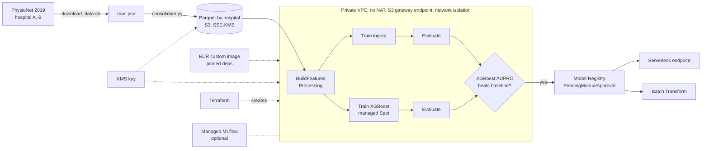

# Sepsis early warning on Amazon SageMaker (PhysioNet/CinC 2019)

An hourly sepsis early-warning model, built to show a secure, reproducible SageMaker workflow:
data ingestion, causal feature engineering in a custom container, training, patient-level
bootstrap evaluation on an **external hospital**, a SageMaker Pipeline with conditional model
registration, and serving. The pipeline and its engineering practices matter more here than the
model's raw performance.

> **Research demonstration only. Not a medical device and not for clinical use.**

## Status

| Piece | State |
|---|---|
| Secure environment (Terraform: VPC, KMS, S3, IAM, ECR, budget) | Done, applied |
| Ingestion, consolidation, data summary | Done, counts reconcile ([docs/data_summary.md](docs/data_summary.md)) |
| Causal features + patient-level splits, SageMaker Processing job | Done; cloud output identical to local run |
| Training (logistic regression, XGBoost), local | Done |
| Evaluation with patient-bootstrap CIs, hospital B external | Done (local models) |
| SHAP and subgroup analysis (Clarify fallback) | Done |
| SageMaker Pipeline with conditional registration | Defined and accepted by SageMaker; **not yet executed** |
| SageMaker training jobs (Spot), hyperparameter tuning, MLflow | **Blocked on training instance quota** (requested) |
| Serverless endpoint, Batch Transform | Handler and container verified locally; **cloud deployment pending** |

Numbers below come from models trained locally; they will be refreshed from the SageMaker
pipeline run (`scripts/render_results.py`).

## Architecture



Everything is created by Terraform (`infra/`) and driven from your machine with the SageMaker
Python SDK. One custom image (`container/`) runs feature building, training, evaluation and
inference, so the same `features.py` is used offline and at serving time.

## Methodology rules (enforced by code and tests)

1. Hospital A is split into train/validation **by patient**, stratified on ever-septic; hospital B is
   only ever used for final evaluation.
2. Nothing is tuned on hospital B: hyperparameters, calibration and the alert threshold are fit on
   hospital A validation.
3. Features are causal: a feature at hour *t* uses only rows at hours ≤ *t* (tested by perturbing
   later rows; serving is tested the same way).
4. Fitted preprocessing (imputation, scaling) is fit on the training fold only.
5. Confidence intervals come from a bootstrap that resamples patients, not rows (tested).

## Results

<!-- results:headline:start -->
_Source: local run (models trained locally; SageMaker pipeline run pending). 95% CIs from 1000 patient-level bootstrap resamples. Calibration and alert threshold fit on hospital A validation only; hospital B is an untouched external test set._

| Metric | XGBoost, A validation | XGBoost, B (external) | Logistic regression, A validation | Logistic regression, B |
|---|---|---|---|---|
| Patients (septic) | 4,067 (358) | 20,000 (1,142) | 4,067 (358) | 20,000 (1,142) |
| Hour prevalence | 0.0216 | 0.0141 | 0.0216 | 0.0141 |
| AUROC | 0.800 (0.782-0.820) | 0.776 (0.764-0.787) | 0.754 (0.732-0.776) | 0.711 (0.697-0.725) |
| AUPRC | 0.117 (0.101-0.138) | 0.056 (0.051-0.063) | 0.097 (0.087-0.115) | 0.049 (0.045-0.056) |
| Brier (calibrated) | 0.020 (0.018-0.022) | 0.014 (0.013-0.014) | 0.020 (0.018-0.022) | 0.015 (0.014-0.017) |
| Challenge utility (normalised) | 0.382 (0.336-0.424) | 0.245 (0.221-0.270) | 0.332 (0.287-0.372) | 0.194 (0.169-0.219) |
| Median lead time, h | 35.0 (27.5-42.0) | 32.0 (29.0-37.0) | 38.0 (30.0-45.0) | 30.0 (27.0-37.0) |
| Septic patients alerted before onset | 0.858 (0.822-0.893) | 0.704 (0.676-0.730) | 0.737 (0.693-0.783) | 0.593 (0.564-0.621) |
| False alarms per non-septic patient-day | 4.33 (4.11-4.56) | 1.87 (1.77-1.97) | 2.98 (2.80-3.15) | 2.07 (1.97-2.18) |

XGBoost alert threshold: 0.0243 (calibrated probability).
<!-- results:headline:end -->

Reading the table: every metric is lower on hospital B, the expected cost of external validation.
Hour prevalence also differs (A 2.2%, B 1.4%), so AUPRC is not comparable across hospitals; compare
each against its own prevalence. The alert threshold maximises the challenge utility, which charges
very little for false alarms, so it implies about 2 to 4 false alarms per non-septic patient-day. That is
not a clinically usable burden (see [docs/future_work.md](docs/future_work.md)).

### What drives the model (XGBoost, SHAP)

<!-- results:shap:start -->
| Variable | Share of total |SHAP|, A validation | Share, B |
|---|---|---|
| FiO2 | 12.9% | 10.7% |
| ICULOS | 12.9% | 11.2% |
| Temp | 6.9% | 6.1% |
| Resp | 5.6% | 5.2% |
| Lactate | 5.4% | 4.7% |
| Unit1 | 5.2% | 4.6% |
| SBP | 4.7% | 4.5% |
| Creatinine | 3.9% | 4.1% |
<!-- results:shap:end -->

More in [docs/model_card.md](docs/model_card.md).

## Reproduce

Prerequisites: Python 3.11 and [uv](https://docs.astral.sh/uv/), Terraform ≥ 1.6, AWS CLI, Docker,
an AWS account/profile. On macOS, XGBoost needs `brew install libomp`.

```bash
uv sync --extra dev
cp config/settings.example.yaml config/settings.yaml      # edit: profile, region, owner, budget email
scripts/infra.sh apply                                    # BILLABLE resources: read infra/ first
uv run python scripts/consolidate.py --upload             # after scripts/download_data.sh
uv run python scripts/explore.py                          # -> docs/data_summary.md
uv run python -m sepsis.process --input data/parquet --output data/features
scripts/push_image.sh                                     # build + push the custom image
uv run python scripts/run_processing.py --compare-local data/features   # Phase 3 acceptance
uv run python -m sepsis.train --model xgboost --train data/features/train \
    --validation data/features/validation --model-dir outputs/xgboost_full
uv run python -m sepsis.evaluate --model-dir outputs/xgboost_full --features data/features \
    --out outputs/eval_xgboost
uv run python scripts/run_pipeline.py --upsert --start    # features -> train -> evaluate -> register
make test lint                                            # unit tests and ruff
scripts/teardown.sh                                       # delete everything
```

Each script runs locally on a small sample first (`consolidate.py --limit 500`). Some accounts
start with **zero quota for training and transform instances**; request `ml.m5.large` training,
Spot training and transform quota early, as approval can take a day.

### Calling the endpoint

Request format ([docs/sample_request.json](docs/sample_request.json) is a 12-hour example):

```json
{"patient_id": "B_p100013",
 "records": [{"ICULOS": 1, "HR": 84, "O2Sat": 98, "Age": 89, "Gender": 1}, "... one row per ICU hour ..."],
 "all_hours": false}
```

Response (verified against the container; endpoint deployment pending):

```json
{"patient_id": "B_p100013", "iculos": 12, "n_hours": 12, "risk_score": 0.0533,
 "alert": true, "calibrated": true, "model": "xgboost"}
```

Rows must be consecutive hours (`ICULOS` increasing by 1); other bad input returns HTTP 400.

## Layout

`infra/` Terraform · `container/` image · `src/sepsis/` package (io, splits, features, train, metrics,
evaluate, explain, inference, pipeline) · `scripts/` entry points · `third_party/evaluation_2019/`
official scoring code, vendored unmodified (BSD-2) · `tests/` · `docs/`.

## Versions

Python 3.11 · **sagemaker 3.25.0** (v3 SDK, pinned; its API differs from v2) · xgboost 3.2.0 ·
scikit-learn 1.9.1 · pandas 3.0.6 · Terraform AWS provider ~> 6.0. Resources are tagged
`project=sepsis-sagemaker`, `owner`, `env=demo`.

## Cost

Design choices: no NAT gateway and no interface endpoints (S3 gateway endpoint only), Spot training,
serverless inference and Batch Transform instead of real-time endpoints, an AWS Budgets alarm, and
a teardown script. Approximate running costs: one KMS key about $1 per month, S3 and ECR storage
cents per month, a Processing or Training run cents, managed MLflow about $0.60 per hour while the
tracking server exists (off by default). Actual spend to date: *to be filled from Cost Explorer at
project close.*

## Limitations

Retrospective data from two hospital systems; the label is a time-shifted sepsis criterion, not a
clinician diagnosis; `ICULOS` and which labs were ordered carry signal (clinician behaviour);
performance drops on the external hospital; probabilities are calibrated on hospital A; no
prospective or workflow evaluation; alert burden at the utility-optimal threshold is high.

## Data and attribution

PhysioNet/Computing in Cardiology Challenge 2019 (CC BY 4.0). Reyna MA et al., *Early Prediction of
Sepsis From Clinical Data*, Critical Care Medicine 48(2), 2020. Scoring code from
<https://github.com/physionetchallenges/evaluation-2019> (BSD-2).
